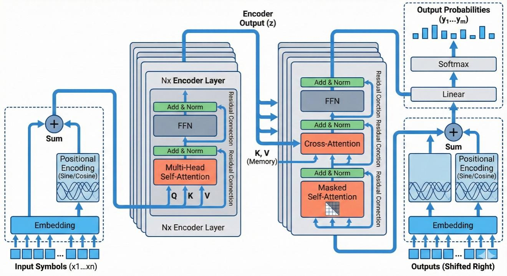
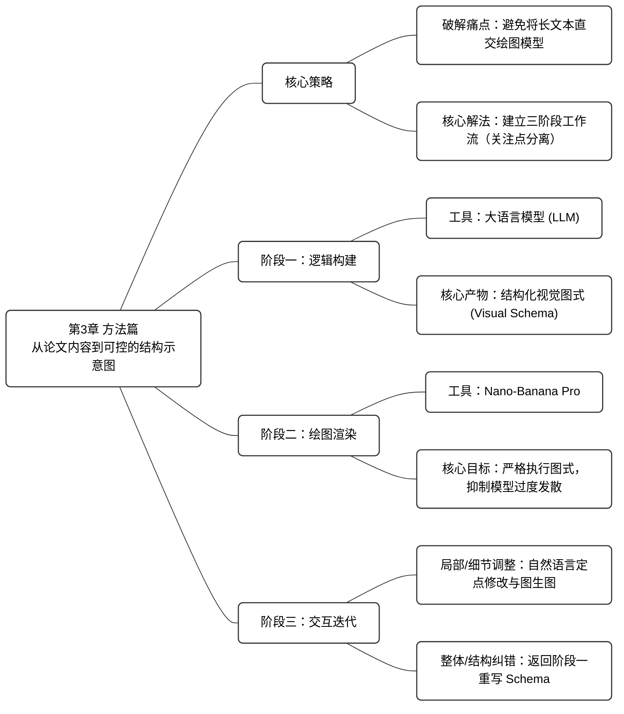

# 第3章 提示词工程：把晦涩论文转化为高质量图表框架

> [!NOTE]
> **本章导学**
> - 理解为什么不建议将长篇论文直接交给绘图模型
> - 掌握"三阶段工作流"：逻辑构建、绘图渲染与交互迭代
> - 学会编写结构化视觉图式（Visual Schema）
> - 掌握通过自然语言和图生图进行细节微调的技法

第 02 章已经系统介绍了 Nano-Banana Pro 的主要使用方式与配套工具，解决了科研绘图过程中“如何调用模型与工具”的问题。然而在真正进入科研绘图实践后，你会发现，工具层面的熟练程度并不足以保证插图质量。

在实际科研场景中，广大研究者更普遍的困惑在于：对方法本身的逻辑、模块之间的关系和原理演化过程非常清楚，却难以将这些内容转化为一个视觉清晰、结构合理、且符合规范的页面布局。即便你已经掌握了文生图或图生图的基本技巧，也依然容易卡在“这张图该怎么组织”“从哪一个模块开始画”这类问题上。

因此，本章将不再零散地讨论单一技巧，而是围绕科研插图生成这一具体目标，把前一章中介绍的工具能力、模型特性与科研绘图的真实需求系统地串联起来，给出一套以论文文本为起点，最终产出可控科研插图素材的完整方法论。

## 3.1 核心策略

在科研绘图实践中，文生图或图生图更多承担的是执行层面的角色，其效果高度依赖于一个前提条件：你是否已经对整张图的整体布局与拓扑连接关系做出了清晰决策。当这一前提缺失时，即便对论文内容理解充分，研究者依然很难判断各模块应当如何在二维画面中展开，以及空间位置与层级关系应当如何安排。

在这种情况下，许多初学者会做出一个看似省力、实则风险极高的策略选择：试图将从论文文本到最终插图的全部转换过程直接交由绘图模型完成。

然而，虽然 Nano-Banana Pro 具备一定的文本理解能力，本书并不推荐直接将完整论文交由其进行绘图。科研论文本质上是面向同行阅读的线性文本，其中包含大量默认共识与省略信息，并不适合作为绘图模型的直接输入。如果跳过中间环节，直接让模型处理论文内容，往往会出现结构过度简化、模块被错误合并等问题。同时，Nano-Banana Pro 直出的图片通常仍需要多轮交互迭代才能满足科研使用标准。

> [!IMPORTANT]
> **科研绘图的三阶段工作流**
> 1. **阶段一：逻辑构建** —— 将论文文本转化为空间结构描述（由 LLM 完成）
> 2. **阶段二：绘图渲染** —— 严格遵循图式指令生成图像（由 Nano-Banana Pro 完成）
> 3. **阶段三：交互迭代** —— 针对非结构性问题进行定点微调（人机协作完成）

这套工作流的设计核心在于关注点分离。**阶段一只解决画什么的问题**，重点保证结构与逻辑的准确性；**阶段二聚焦如何画**，强调视觉呈现的稳定性；**阶段三用于处理细节层面的修正与完善**。

3.2 节~ 3.4节将依次对这三个阶段展开说明，并给出对应的操作提示词与实践细节。

## 3.2 阶段一：逻辑构建

在阶段一，研究者可借助大语言模型（Large Language Model， LLM），将论文内容转化为一份结构化的 \[VISUAL SCHEMA\]（视觉图式，以下简称 Schema）。该过程并不涉及图像生成，而是要求模型输出一份面向绘图模型使用的结构描述文本，其中需要包含明确的空间布局、模块关系与视觉约束信息。

在这一阶段中，LLM 承担的是“结构设计者”的角色。我们**利用其较强的语言理解与逻辑推理能力**，例如 Gemini、GPT、Claude，以及国内的 Kimi、GLM、DeepSeek 等系列的旗舰模型，**对论文内容进行重组与抽象，用以明确插图应当呈现的核心信息、模块划分方式以及整体画面设计思路**。

结合第 02 章中介绍的文生图技巧，这一步的目标是让 LLM 输出一份可直接用于下一阶段的结构化提示内容，并在其中显式指定插图风格与布局形式。为此，提示词中通常会引入对应领域的顶级会议或期刊作为风格参照，同时提供若干常见的布局原型供模型选择，以降低生成结果的不确定性。

如果你对所要绘制内容的逻辑关系已经非常清楚，可以将现有的文字说明、流程图、伪代码或相关笔记，与论文正文一并提供给 LLM，作为结构构建的输入依据；如果对本领域中常见的插图布局形式缺乏把握，则可以先收集几篇具有代表性的论文插图，让 LLM 对其进行归纳与总结，再将得到的布局类型与设计特征补充进提示词中。这种做法在实践中能够显著提升模型输出结果与领域主流审美之间的一致性。

下面我们以计算机视觉与机器学习领域为例，给出一个完整的逻辑构建提示词示例（读者可直接使用）。

```markdown
# Role 
你是一位 CVPR/NeurIPS 顶会的**视觉架构师**。你的核心能力是将抽象的论文逻辑转化为**具体的、结构化的、几何级的视觉指令**。 
 
# Objective 
阅读我提供的论文内容，输出一份 **[VISUAL SCHEMA]**。这份 Schema 将被直接发送给 AI 绘图模型，因此必须使用**强硬的物理描述**。 
 
# Phase 1: Layout Strategy Selector (关键步骤：布局决策) 
在生成 Schema 之前，请先分析论文逻辑，从以下**布局原型**中选择最合适的一个（或组合）： 
1.  **Linear Pipeline**: 左→右流向 (适合 Data Processing, Encoding-Decoding)。 
2.  **Cyclic/Iterative**: 中心包含循环箭头 (适合 Optimization, RL, Feedback Loops)。 
3.  **Hierarchical Stack**: 上→下或下→上堆叠 (适合 Multiscale features, Tree structures)。 
4.  **Parallel/Dual-Stream**: 上下平行的双流结构 (适合 Multi-modal fusion, Contrastive Learning)。 
5.  **Central Hub**: 一个核心模块连接四周组件 (适合 Agent-Environment, Knowledge Graphs)。 
 
# Phase 2: Schema Generation Rules 
1.  **Dynamic Zoning**: 根据选择的布局，定义 2-5 个物理区域 (Zones)。不要局限于 3 个。 
2.  **Internal Visualization**: 必须定义每个区域内部的“物体” (Icons, Grids, Trees)，禁止使用抽象概念。 
3.  **Explicit Connections**: 如果是循环过程，必须明确描述 "Curved arrow looping back from Zone X to Zone Y"。 
 
# Output Format (The Golden Schema) 
请严格遵守以下 Markdown 结构输出： 
 
---BEGIN PROMPT--- 
 
[Style & Meta-Instructions]  High-fidelity scientific schematic, technical vector illustration, clean white background, distinct boundaries, academic textbook style. High resolution 4k, strictly 2D flat design with subtle isometric elements. 
 
[LAYOUT CONFIGURATION] 
* **Selected Layout**: [例如：Cyclic Iterative Process with 3 Nodes] 
* **Composition Logic**: [例如：A central triangular feedback loop surrounded by input/output panels] 
* **Color Palette**: Professional Pastel (Azure Blue, Slate Grey, Coral Orange, Mint Green). 
 
[ZONE 1: LOCATION - LABEL] 
* **Container**: [形状描述, e.g., Top-Left Panel] 
* **Visual Structure**: [具体描述, e.g., A stack of documents] 
* **Key Text Labels**: "[Text 1]" 
 
[ZONE 2: LOCATION - LABEL] 
* **Container**: [形状描述, e.g., Central Circular Engine] 
* **Visual Structure**: [具体描述, e.g., A clockwise loop connecting 3 internal modules: A (Gear), B (Graph), C (Filter)] 
* **Key Text Labels**: "[Text 2]", "[Text 3]" 
 
[ZONE 3: LOCATION - LABEL]  ... (Add Zone 4/5 if necessary based on layout) 
 
[CONNECTIONS] 
1.  [描述连接线, e.g., A curved dotted arrow looping from Zone 2 back to Zone 1 labeled "Feedback"] 
2.  [描述连接线, e.g., A wide flow arrow from Zone 2 to Zone 3] 
 
---END PROMPT--- 
 
# Input Data 
[论文相关内容]
```

这里我们选取“Attention Is All You Need”论文的第 03 章作为输入素材，得到的结构化输出如图 3-1　所示。

<div align="center">
  <br>
  图 3-1　Transformer 架构的 Schema 生成结果（截选）
</div>

> [!TIP]
> **本书建议**：为避免最终成图与逻辑脱节，建议在进入阶段二前，仔细检查 Schema 中的结构与风格描述是否准确。这一步的校准能显著提高出图成功率.

## 3.3 阶段二：绘图渲染 

在完成逻辑构建后，流程才进入真正的绘图阶段。此时，LLM 已经提供了一份包含明确布局与风格约束的 Schema，因此本阶段提示词的关注重点也随之发生转移，由“逻辑定义”转向“结构执行”。

在这一阶段，核心目标是**抑制模型的幻觉行为与过度发挥，确保生成结果尽可能精准地还原 Schema 中定义的空间位置与几何关系**。绘图提示词应重点强调空间布局、视觉元素类型与整体风格约束。同时，结合具体学科领域的顶级期刊审美标准，对画面的风格进行再次确认。

此外，需要注意的是，Nano-Banana Pro 在部分情况下会将结构性提示词中的示意文本误判为需要渲染的画面文字。为避免这一问题，应在提示词中对可渲染文字范围进行明确约束，从而减少后续在文字层面反复修正的成本。

这里我们依然以计算机视觉与机器学习领域为例，给出一个完整的绘图渲染提示词示例。

```markdown
**Style Reference & Execution Instructions:** 
 
1.  **Art Style (Visio/Illustrator Aesthetic):** 
    Generate a **professional academic architecture diagram** suitable for a top-tier computer science paper (CVPR/NeurIPS). 
    * **Visuals:** Flat vector graphics, distinct geometric shapes, clean thin outlines, and soft pastel fills (Azure Blue, Slate Grey, Coral Orange). 
    * **Layout:** Strictly follow the spatial arrangement defined below. 
    * **Vibe:** Technical, precise, clean white background. NOT hand-drawn, NOT photorealistic, NOT 3D render, NO shadows/shading. 
 
2.  **CRITICAL TEXT CONSTRAINTS (Read Carefully):** 
    * **DO NOT render meta-labels:** Do not write words like "ZONE 1", "LAYOUT CONFIGURATION", "Input", "Output", or "Container" inside the image. These are structural instructions for YOU, not text for the image. 
    * **ONLY render "Key Text Labels":** Only text inside double quotes (e.g., "[Text]") listed under "Key Text Labels" should appear in the diagram. 
    * **Font:** Use a clean, bold Sans-Serif font (like Roboto or Helvetica) for all labels. 
 
3.  **Visual Schema Execution:** 
    Translate the following structural blueprint into the final image: 
 
[[VISUAL SCHEMA]的全部内容]
```

当我们将这些提示词交给 Nano-Banana Pro 后，便可以得到一份看得过去的插图初稿了。以图 3-1　中得到的 Transformer 架构 Schema 作为输入，模型的输出结果如图 3-2　所示。

<div align="center">
<table>
  <tr>
    <td align="center"></td>
  </tr>
</table>
图 3-2　基于 Schema 生成的 Transformer 架构插图初稿
</div>

## 3.4 阶段三：交互迭代

在获得插图初稿后，流程进入交互迭代阶段。尽管整体风格与结构已经基本符合预期，但受限于论文本身的复杂性，Nano-Banana Pro 未必能够在一次生成中准确呈现所有细节。例如在图 3-2 中，如果仔细观察细节，会发现右侧出现了 "Residual Conction"的拼写错误，且每个残差模块旁都重复堆叠了竖排文字。这种视觉上的冗余不仅导致画面右侧过于拥挤，也干扰了核心信息的传递。因此，对初稿进行有针对性的修改与优化，依然是不可或缺的步骤。

从实践经验来看，常见问题主要可以归为两类：整体布局正确但局部细节或风格存在偏差，以及整体布局本身出现错误。为应对这两类问题，本书推荐的核心原则，是**尽量减少无目的的重复生成，而是充分利用 Nano-Banana Pro 在自然语言编辑方面的能力，对已有结果进行精确修改**。

**1. 整体布局满意，但细节或风格有瑕疵**

当插图的整体结构、模块关系与空间布局已经满足预期，仅在局部元素、配色或视觉风格上存在瑕疵时，建议**采用自然语言编辑策略进行修正**。

在 Google AI Studio 或 Gemini 网页端等多轮对话式环境中，若该图片仍在对话的上下文中，你可以直接在对话框输入修改指令（如图 3-3）；若该图片不在对话的上下文中，或在 API 等非交互式调用场景下，则可通过图生图方式，将当前结果作为参考图再次输入模型进行编辑（如图 3-4）。无论采用哪种方式，模型都能够在保持主体结构稳定的前提下，对所指定的元素进行针对性修改。

<div align="center">
  <br>
  图 3-3　在多轮对话式环境中修改图像细节
</div>

<div align="center">
<table>
  <tr>
    <td align="center"><br>(a)</td>
    <td align="center"><br>(b)</td>
  </tr>
</table>
图 3-4　利用图生图方式修改图像细节（a）上传待处理图像；（b）输入修改指令
</div>

表 3-2　汇总了科研绘图中常见的自然语言编辑指令示例，涵盖图标替换、颜色调整、风格统一与文字修正等高频需求。*斜体部分*为可变参数，需根据实际情况代入。

表 3-2　常见的自然语言编辑指令示例

| **指令名称** | **英文指令** | **中文指令** |
| :--- | :--- | :--- |
| 修改图标 | Change the '*Gear*' icon in the center to a '*Neural Network*' icon | 把中间的*齿轮*换成*神经网络图标* |
|  | Replace the *robot head* with *a simple document symbol* | 把*机器人头*换成*文档符号* |
| 调整颜色 | Make the background of the *left panel pure white* instead of *light blue* | 把*左边面板*的背景改成*纯白* |
|  | Change the *orange arrows* to *dark grey* | 把*橙色箭头*改成*深灰色* |
| 风格统一 | Make all lines *thinner and cleaner* | 让所有线条*更细更清晰* |
|  | Remove the *shading effect*, make it *completely flat 2D* | 去掉阴影效果，做成*完全扁平的 2D 风格* |
| 文字修正 | Correct the text '*ZONNE*' to '*ZONE*' | 修正拼写错误，将 *ZONNE* 改为 *ZONE* |
|  | Remove the text labels | 去掉所有文字标签 |

需要额外说明的是，尽管 Nano-Banana Pro 相较于同类模型在文字渲染能力上已经有明显优势，但在复杂结构或多标签场景下仍可能出现拼写错误或字体异常。如果文字错误较为集中或影响整体观感，更稳妥的处理方式是直接移除图中所有文字标签，在后处理阶段通过矢量编辑或排版软件统一添加说明文字。

> [!TIP]
> **本书建议**：由于模型的每次生成与修改都会叠加新的水印层，多层堆叠将导致后期难以完美修复。因此，建议参考 2.3.2 节所介绍的去水印工具，在每一次生成或修改完成后，立即去除当次产生的可见水印，避免累积。

**2. 整体布局错误**

如果你发现生成结果在结构层面出现明显偏差，例如原本应为循环关系的流程被绘制为线性结构，或关键模块之间的因果关系被错误表达，此时不建议继续通过局部修改进行修补。

这类问题通常意味着阶段一生成的 Schema 在结构描述上存在歧义或信息缺失。更有效的做法是**回到阶段一，对Schema 进行检查与修订，重点确认是否选择了合适的布局策略**，即3.2节中Schema 输出的`[LAYOUT CONFIGURATION]`部分，以及各个Zone中对模块关系与空间组织的描述是否足够明确。

在实际操作中，你可以直接与 LLM 进行交互，要求它基于你的修正意见重新生成 Schema 作为新的结构蓝图，再重新执行阶段二的绘图渲染流程。这种方式往往能够从根本上解决结构性错误问题。

**3.关于多次生成与抽卡策略的有效性说明**

在 AI 绘图实践中，使用同一提示词生成多张结果以进行筛选，是一种常见操作。需要说明的是，Nano-Banana Pro 在图像编辑与结构保持方面已经具备较高稳定性。**当一张插图在整体结构和风格层面已经达到较高完成度时，并不建议频繁重新生成。**

在本书所推荐的提示词体系下，整体布局与视觉风格已经被较为严格地约束，多次生成之间的差异通常集中在线条路径、局部元素配色或细节处理层面，而不会对整体结构产生显著影响。如果你已经预先确定了明确的配色方案或风格规范，更高效的方式是基于当前结果，通过自然语言指令对局部细节进行定点修改。

图 3-5 展示了在相同提示词条件下生成的两张插图结果，可以看到二者在整体布局和视觉语言上的差异并不显著。

<div align="center">
<table>
  <tr>
    <td align="center"><br>(a)</td>
    <td align="center"><br>(b)</td>
  </tr>
</table>
图 3-5　相同提示词下的生成稳定性测试 (a) 结果a；(b) 结果b
</div>

> [!TIP]
> **本章核心结论速查**
> - **关注点分离**：不要试图一步到位，先定结构（Schema），再定渲染，最后微调细节
> - **视觉图式（Schema）**：它是连接论文文本与绘图模型的“逻辑桥梁”，必须包含空间布局与物理描述
> - **迭代策略**：结构错，回阶段一改 Schema；细节错，在阶段三用自然语言或图生图修补
> - **稳定性保障**：利用结构化提示词约束模型的幻觉，确保生成结果符合学术严谨性

## 3.5 小结

本章围绕科研绘图的实际需求，系统介绍了一套从论文内容到可控结构示意图的完整方法流程。通过将逻辑构建、绘图渲染与交互迭代分阶段处理，可以有效降低科研插图生成过程中的不确定性，并提升整体效率。为了帮助你更直观地复盘本章要点，下面将本章核心内容整理为了一张全景式的知识脉络图。



<div align="center">
  图 3-6　第 03 章知识脉络图
</div>

需要再次强调的是，本章所产出的成果定位于AI 生成的科研插图素材，仍然处于可编辑、可优化的中间阶段。如何将这些素材进一步提升至可直接用于投稿的发表级插图，将在第 05 章中结合后处理工具与实践经验展开详细讨论。