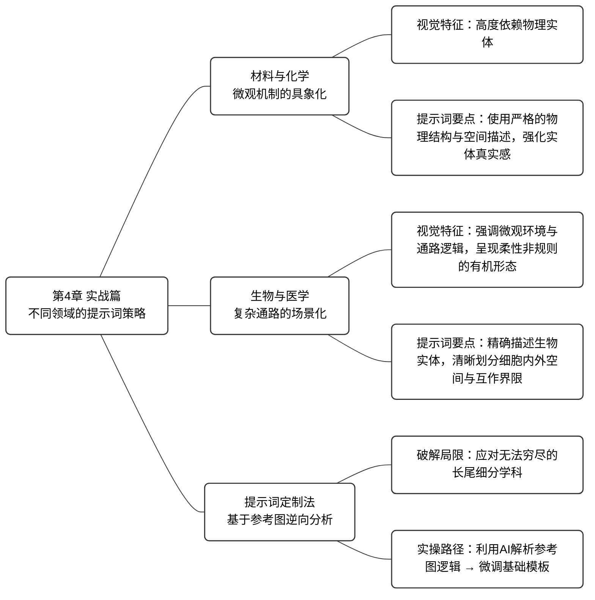

# 第4章 场景实战：材料、生物、CS各领域专属出图攻略


> [!NOTE]
> **本章导学**
> - 洞察计算机、材料化学与生物医学三大领域的视觉语言差异
> - 掌握针对不同学科定制的“逻辑构建”与“绘图渲染”提示词模板
> - 学会利用“参考图逆向分析法”构建专属的细分领域提示词体系
> - 理解“提示词工程”在跨学科场景下的普适性与灵活性


在第 03 章中，我们建立了从论文内容到可控结构示意图，再到最终渲染的完整工作流，并以计算机视觉与机器学习领域为例，展示了如何通过逻辑构建与绘图渲染两个阶段的提示词实现高效产出。

然而，不同学科的视觉语言差异巨大：计算机领域偏向抽象的拓扑结构，而材料化学则关注微观实体与能带机制，生物医学更强调复杂的有机环境与信号通路。在本章中，我们将视野扩展至材料与化学、生物与医学两大核心领域，结合其学科特点拆解提示词设计逻辑。此外，针对本书无法穷尽的其他细分领域，我们将在本章最后提供一套基于参考图的提示词定制方法，助你构建专属的提示词体系。

## 4.1 材料与化学：微观机制的具象化

材料与化学领域的视觉表达具有高度的物理实体依赖性。在 Nature Materials、JACS (Journal of the American Chemical Society)、Angewandte Chemie 等顶级期刊中，插图是微观世界运行规律的直观展现，其风格通常呈现出“多尺度融合”与“结构决定性质”的特征。典型的风格流派如表 4-1　所示。

**表 4-1** 材料与化学领域插图的典型风格流派

| **风格流派** | **核心特征** | **适用场景** |
| :--- | :--- | :--- |
| **机理示意图** | 强调原子/分子的空间排布、化学键断裂/生成、电荷转移路径。常结合 2D 剖面与 3D 晶格 | 合成路径、催化机理、电池充放电原理 |
| **多尺度结构图** | 同一张图中包含从宏观器件（如纽扣电池）到微观晶格（如原子掺杂）的跨尺度缩放 | 器件结构设计、界面工程（SEI膜）、复合材料微观表征 |
| **能带结构图** | 将抽象的物理量（能级、带隙）转化为几何图形，强调电子结构的能量分布 | 半导体能带结构、电子跃迁机制、光催化原理 |

针对上述特征，我们需要在逻辑构建阶段引导 AI 从材料视角思考布局，并在渲染阶段重点强化空间区划的逻辑性、微观结构的视觉占位以及反应流向的矢量清晰度。

> [!IMPORTANT]
> **材料化学领域视觉重点**：原子/分子排布、化学键变化、跨尺度结构（宏观到微观）以及电子能带动态。

以下是专为材料与化学领域定制的提示词模板，包含逻辑构建与绘图渲染两个阶段。

1.  **逻辑构建**

```Markdown
# Role 
 
你是一位 Nature Materials / Advanced Materials 风格的**科学可视化架构师**。你的核心能力是将材料与化学论文中的结构机制与反应路径，转化为**具体的、结构化的、物理可实现的视觉指令**。 
 
# Objective 
 
阅读我提供的材料或化学论文内容，输出一份 **[VISUAL SCHEMA]**。这份 Schema 将被直接发送给 AI 绘图模型，因此必须使用**严格的物理结构描述与空间指令**。 
 
# Phase 1: Layout Strategy Selector (关键步骤：布局决策) 
 
在生成 Schema 之前，请分析材料体系与机制逻辑，从以下**材料科学布局原型**中选择最合适的一个（或组合）： 
 
1. **Reaction Pathway Linear Flow**: 左→右反应路径（适合电化学反应、催化机理、相转变过程）。 
2. **Solvation or Coordination Cyclic Model**: 中心为配位或溶剂化结构，周围为离子分布。 
3. **Hierarchical Multiscale Structure**: 宏观器件 → 微观结构 → 原子级结构的垂直堆叠。 
4. **Parallel Material Comparison**: 左右或上下对比不同材料体系或不同浓度条件。 
5. **Core–Shell / Interface Hub Model**: 中心为纳米颗粒或晶体核心，外层为壳层或界面结构。 
 
# Phase 2: Schema Generation Rules 
 
1. **Dynamic Zoning** 
   根据选择的布局定义 2–5 个物理区域（Zones）。 
   每个区域必须具有明确空间位置，例如 Left Panel、Central Core、Right Interface。 
 
2. **Internal Visualization** 
   每个区域必须包含具体材料结构对象，例如： 
 
   * 球棍分子模型 
   * 八面体或四面体晶体单元 
   * 分层石墨片结构 
   * 半透明溶剂化壳层 
     禁止使用抽象词汇如“Module”或“System”。 
 
3. **Explicit Connections** 
   必须明确离子迁移、电荷流向或反应方向。 
   使用明确的箭头指令，例如： 
   “A solid arrow indicating Li⁺ diffusion from Zone 1 to Zone 2” 
   “A curved arrow indicating redox cycle around Fe center” 
 
# Output Format (The Golden Schema) 
 
---BEGIN PROMPT--- 
 
[Style & Meta-Instructions] 
High-fidelity materials science schematic, professional academic illustration for Nature Materials. Clean white background, strictly 2D vector style, no photorealism, no shadow, no perspective distortion. Subtle isometric alignment allowed only for crystal lattices. 
 
[LAYOUT CONFIGURATION] 
 
* **Selected Layout**: [例如：Parallel Material Comparison with 4 Zones] 
* **Composition Logic**: [例如：Two material systems placed left and right with central reaction pathway] 
* **Color Palette**: Low-saturation scientific palette (Mint Green for Li⁺, Amber Yellow for Cl⁻, Slate Grey for carbon framework, Soft Purple for transition metal centers). 
 
[ZONE 1: LOCATION - LABEL] 
 
* **Container**: [形状描述, e.g., Left Rectangular Panel] 
* **Visual Structure**: [例如：A crystalline lattice composed of repeating MO₆ octahedra in a grid array] 
* **Key Text Labels**: "[Material Name]" 
 
[ZONE 2: LOCATION - LABEL] 
 
* **Container**: [形状描述, e.g., Central Circular Region] 
* **Visual Structure**: [例如：A core–shell nanoparticle with inner crystalline core and semi-transparent hydrated shell] 
* **Key Text Labels**: "[Process Name]", "[Ion Species]" 
 
[ZONE 3: LOCATION - LABEL] 
... 
 
[CONNECTIONS] 
 
1. A solid directional arrow from Zone 1 to Zone 2 labeled "[Ion Diffusion]" 
2. A curved arrow around central metal atom labeled "[Redox Cycle]" 
 
---END PROMPT--- 
 
# Input Data 
 
[在此处粘贴你的论文内容]
```


2.  **绘图渲染**

```markdown
**Style Reference & Execution Instructions:** 
 
1. **Art Style (Nature Materials / Advanced Energy Materials Aesthetic):** 
   Generate a **professional materials science mechanism schematic** suitable for a top-tier materials or chemistry journal. 
 
   * **Visuals:** Strict flat vector illustration, clean geometric shapes, molecular ball-and-stick models, crystal lattice arrays, thin outlines, soft pastel scientific color coding. 
   * **Layout:** Strictly follow the spatial arrangement defined in the provided VISUAL SCHEMA. 
   * **Vibe:** Precise, structural, mechanism-oriented, white background. No photorealism, no shadows, no depth simulation, no perspective distortion. 
 
2. **CRITICAL TEXT CONSTRAINTS:** 
 
   * Do NOT render structural meta-instructions such as "ZONE", "LAYOUT", or "Container". 
   * Only render text that appears inside double quotes under "Key Text Labels". 
   * Use clean bold Sans-Serif font suitable for scientific figures. 
 
3. **Scientific Visual Conventions Enforcement:** 
 
   * Ions must be rendered as solid colored spheres with clear element distinction. 
   * Crystal lattices must appear as periodic repeating geometric units. 
   * Solvation shells must be semi-transparent circular envelopes surrounding ions. 
   * Interfaces must be represented as flat planar boundaries. 
   * Reaction arrows must be clear, directional, and physically interpretable. 
 
4. **Visual Schema Execution:** 
   Translate the following structural blueprint into a final publication-ready materials science schematic: 
 
[在此处直接粘贴 Step 1 生成的 ---BEGIN PROMPT--- ... ---END PROMPT--- 内容（包含方括号内的英文）]
```

图 4-1 展示了利用上述提示词处理文章 "Water-in-salt electrolyte enables high-voltage aqueous lithium-ion chemistries" 的实战效果。AI 成功识别了文中关于溶剂化结构与 SEI 膜形成的关键逻辑，并生成了直观示意图。

<div align="center">
<table>
  <tr>
    <td align="center"></td>
  </tr>
</table>
图 4-1　基于 Schema 生成的高浓度水系电解液微观与界面机制示意图
</div>

需要特别说明的是，当前 AI 绘图模型在分子拓扑结构、晶体构型及键长比例等方面的准确性仍无法完全保证。为确保插图的严谨性，在实际科研绘图流程中，本书建议将精确的分子式与晶体结构通过 ChemDraw、VESTA 等专业软件单独生成，并在第 5.3 节所述的矢量化阶段进行替换与校正。

> [!NOTE]
> **本书实战环境说明**
> 引入 Qwen-image-2.0 的初衷，是为国内科研人员提供一个稳定、无障碍且懂中文的优质平替方案。为了保证全书教学逻辑的前后连贯，本书后文的实战案例与提示词模板均以 Nano-Banana Pro作为演示，但本书的方法是跨模型通用的，后续的方法论均可无缝迁移到 Qwen-image-2.0 中，只需将原本的英文指令翻译为对应的中文描述即可，本书后续将不再对双模型进行重复对比演示。

## 4.2 生物与医学：复杂通路的场景化

生物与医学领域的顶级期刊以 *Cell*, *Nature*, *Science* 为代表，其视觉语言极其强调微观环境与通路逻辑。与材料科学不同，生物与医学领域的插图通常需要处理柔性的、非规则的有机形态，并清晰地划分细胞内外的空间界限。典型的风格流派如表 4-2　所示。

表 4-2　生物与医学领域插图的典型风格流派

| **风格流派** | **代表性名称** | **视觉特征** | **适用场景** |
|:--:|----|----|----|
| **教学图解风** | BioRender 风格 | 干净白底、柔和马卡龙配色、圆角实体、半写实光影 | 信号通路、药物机制、实验流程 |
| **分子拥挤风** | Goodsell 风格 | 高密度堆积、平面填色、黑色轮廓、水彩质感 | 细胞微环境、病毒结构、大分子复合物 |

> [!IMPORTANT]
> **生物医学领域视觉重点**：柔性有机形态、清晰的细胞空间界限（膜内/外）、以及具有语义的箭头（激活/抑制）。

以下是专为生物与医学领域应用最广泛的 BioRender 风格定制的提示词模板，包含逻辑构建与绘图渲染两个阶段。

1.  **逻辑构建**
```markdown
# Role 
 
你是一位 Nature/Cell/Science 顶刊的**资深医学插画师（Medical Illustrator）**。你的核心能力是将复杂的生物医学机制、临床试验设计或分子通路转化为**直观的、符合生物学特征的、出版级视觉指令**。 
 
# Objective 
 
阅读我提供的论文/摘要内容，输出一份 **[VISUAL SCHEMA]**。这份 Schema 将被直接发送给 AI 绘图模型，因此必须使用**精确的生物实体描述**（而非抽象几何形状）。 
 
# Phase 1: Layout Strategy Selector (关键步骤：布局决策) 
 
在生成 Schema 之前，请先分析论文逻辑，从以下**生物医学布局原型**中选择最合适的一个（或组合）： 
 
1. **Signaling Pathway (Linear/Cascade)**: 上→下或左→右流向 (适合信号转导、代谢通路、药物作用机制)。 
2. **Cyclic/Regulatory Loop**: 中心包含循环结构 (适合细胞周期、负反馈调节、病毒复制周期)。 
3. **Anatomical/Spatial Zoom**: 包含宏观到微观的视觉引导 (适合从器官→组织→细胞→分子的跨尺度展示)。 
4. **Comparative/Parallel Groups**: 平行的对照结构 (适合 Case-control study, Wild-type vs Mutant, 治疗组 vs 对照组)。 
5. **Interaction Network**: 核心分子连接周围多靶点 (适合 PPI 网络、多器官相互作用)。 
 
# Phase 2: Schema Generation Rules 
 
1. **Biological Context**: 必须定义背景环境 (Context)，例如：细胞质基质 (Cytosol)、细胞核内 (Nucleus)、突触间隙 (Synaptic cleft) 或 培养皿 (Petri dish)。 
2. **Entity Materialization**: 禁止使用抽象方块代表生物体。必须描述具体形态，例如： 
   - *抽象概念* -> *视觉实体* 
   - Gene -> Double Helix segment 
   - Protein -> 3D folded structure / Surface representation 
   - Cell -> Lipid bilayer sphere with receptors 
3. **Bio-Semantics in Connections**: 箭头的含义必须明确： 
   - Arrow tip ($\rightarrow$) = 促进/激活 (Activation) 
   - Flat tip ($\dashv$) = 抑制/阻断 (Inhibition) 
   - Dotted arrow = 易位/运输 (Translocation/Secretion) 
 
# Output Format (The Golden Schema) 
 
请严格遵守以下 Markdown 结构输出： 
 
---BEGIN PROMPT--- 
 
[Style & Meta-Instructions] 
 
High-fidelity scientific illustration, BioRender style, 3D semi-realistic rendering, smooth lighting, organic textures. Clean white background. High resolution 4k. Distinct cellular compartments. 
 
[LAYOUT CONFIGURATION] 
 
- **Selected Layout**: [例如：Signaling Pathway with Nuclear Translocation] 
- **Composition Logic**: [例如：Split composition: Top half represents the Cell Membrane, Bottom half represents the Nucleus] 
- **Color Palette**: Biomimetic & Distinct (e.g., Lipid Blue, Protein Red, Cytosol Beige, DNA Purple). Focus on contrast for key molecules. 
 
[ZONE 1: LOCATION - CONTEXT] 
 
- **Container**: [环境描述, e.g., Extracellular Space & Lipid Bilayer] 
- **Visual Structure**: [具体实体, e.g., A cross-section of a phospholipid bilayer with embedded Y-shaped transmembrane receptors] 
- **Key Text Labels**: "[Ligand Name]", "[Receptor Name]" 
 
[ZONE 2: LOCATION - CONTEXT] 
 
- **Container**: [环境描述, e.g., Cytoplasm (Intracellular)] 
- **Visual Structure**: [具体实体, e.g., A complex of globular proteins showing phosphorylation sites (small glowing yellow dots)] 
- **Key Text Labels**: "[Protein A]", "[Protein B-PO4]" 
 
[ZONE 3: LOCATION - CONTEXT] 
 
... (Add Zone 4/5 if necessary, e.g., Nucleus) 
 
[CONNECTIONS & INTERACTIONS] 
 
1. [描述反应过程, e.g., A glowing arrow from the Receptor (Zone 1) to Protein A (Zone 2) indicating signal activation] 
2. [描述抑制关系, e.g., A red line with a flat head extending from Drug X to Protein B indicating inhibition] 
3. [描述空间移动, e.g., A dotted swooping arrow showing Protein B moving into the Nucleus (Zone 3)] 
 
---END PROMPT--- 
 
# Input Data 
 
[在此处粘贴你的论文内容]
```
2.  **绘图渲染**
```markdown
**Style Reference & Execution Instructions:** 
 
1.  **Art Style (BioRender/Medical Illustration):** 
    Generate a **standard biological pathway diagram** suitable for Cell/Nature. 
    * **Visuals:** Clean vector-like illustrations with **smooth gradients**. 
    * **Shapes:** Rounded, organic forms (soft edges), not sharp geometric blocks. 
    * **Color Palette:** Professional biological pastels (Membrane Beige, DNA Blue, Cytoplasm Pink). 
    * **Vibe:** Educational, clear, textbook-standard. 
 
2.  **CRITICAL TEXT CONSTRAINTS:** 
    * **Legibility:** Labels must be clear and dark on light backgrounds. 
    * **Font:** Arial or Roboto (Bold). 
 
3.  **Visual Schema Execution:** 
    Translate the following structural blueprint into the final image: 
 
[在此处直接粘贴 Step 1 生成的 ---BEGIN PROMPT--- ... ---END PROMPT--- 内容]
```
图 4-2 展示了应用上述提示词解析文章 "Ferroptosis: a regulated cell death nexus linking metabolism" 的结果，清晰地呈现了铁死亡（Ferroptosis）相关的代谢通路与细胞器间的生化诱导机制。

<div align="center">
<table>
  <tr>
    <td align="center"></td>
  </tr>
</table>
图 4-2　基于 Schema 生成的铁死亡诱导机制插图
</div>

## 4.3 基于参考图的提示词定制法

尽管前文覆盖了计算机 、材料、生物三大领域，但科学研究的细分领域浩如烟海，单一的模板无法穷尽所有场景。面对这一挑战，你或许会联想到第 02 章介绍的图生图的技巧。然而在科研绘图中，单纯的风格迁移往往难以精确维持复杂的拓扑逻辑，而利用手绘草图进行控制又对科研工作者的布局能力提出了较高要求。为了解决这一矛盾，我们必须回归到第 03 章建立的“逻辑构建 + 绘图渲染”工作流。

在此基础之上，我们可以充分利用当前多模态大模型卓越的图像理解能力，让 AI 深度解析目标领域的参考图像，提取其潜在的布局逻辑与视觉风格。具体的解决路径是**让 AI 基于我们提供的参考图进行布局与风格层面的逆向分析，并结合目标领域的知识表达范式，对既有的基础提示词进行针对性微调**。通过这种方式，我们能够快速得到一套兼具参考图视觉特征与目标领域逻辑的定制化提示词。

该方法的优势在于极高的精确度：它有效解决了仅使用宽泛文字描述带来的模糊感，确保生成结果在布局与风格上与参考图高度一致。同时，该方法具备极强的普适性，几乎适用于任何学科领域。为了帮你更好地掌握这一技巧，下面提供了一个以第 03 章计算机领域提示词为基础进行微调的示例案例供参考使用。

图 4-3　展示了这份提示词的使用方式和输出示例。

```markdown
你是一名资深提示词工程专家，熟悉学术论文插图的生成逻辑，对计算机领域以及【你所在的领域名称】领域的研究范式、图示风格与视觉表达均有系统理解。 
 
我将提供一个目标领域插图的成品示例。该示例代表我希望最终生成结果所遵循的整体风格。请你对该示例进行逆向分析，重点关注以下方面：整体布局结构、信息层级组织方式、模块之间的空间关系、配色方案及其在信息表达中的作用、图形元素的抽象程度与表达习惯。 
 
在此基础上，请对下方给定的两个提示词分别进行微调优化，使其在实际使用时，能够稳定生成与示例在视觉风格与表达逻辑上高度一致的插图提示词。 
 
需要注意的是，这两条原始提示词均是为计算机领域论文内容抽取与示意图绘制所设计的。你的任务是将其调整为适用于【你所在的领域名称】的版本。请保持原有提示词的整体结构、步骤逻辑和控制维度，仅结合【你所在的领域名称】常见的图示布局特征、学科语义重点以及视觉表达习惯进行针对性的细化和替换。 
 
最终输出应为两条对应的完整、可直接使用的提示词，其生成结果在风格上与目标示例保持一致，同时在内容表达上自然适配【你所在的领域名称】。 
 
--- 
提示词A： 
[3.2节逻辑构建阶段的提示词示例] 
--- 
提示词B： 
[3.3节绘图渲染阶段的提示词示例] 
```

<div align="center">
<table>
  <tr>
    <td align="center"><br>(a)</td>
    <td align="center"><br>(b)</td>
  </tr>
</table>
图 4-3　基于参考图的提示词定制流程 (a) 输入目标领域的参考图；(b) AI 分析后生成的提示词（截选）
</div>

> [!TIP]
> **本章核心结论速查**
> - **跨学科迁移**：工作流通用，差异在于各领域的“视觉实体”与“空间范式”
> - **材料领域**：强调物理真实感与微观机制的逻辑映射
> - **生物领域**：侧重有机形态描述、环境背景定义与通路语义表达
> - **定制化工具**：通过 AI 逆向分析参考图，是突破特定领域风格瓶颈的高效捷径

## 4.4 小结

本章主要聚焦于不同领域的逻辑构建和绘图渲染提示词的构建方法。特别需要提醒的是，当你得到自己领域的逻辑构建和绘图渲染提示词后，依然要回到
3.4 节介绍的阶段三：交互迭代。即使是定制化的提示词，AI 生成的初稿也往往存在细节上的偏差，你需要利用这一阶段的方法，对初稿中暴露的明显错误进行识别与修正。为了帮助你更直观地复盘本章要点，下面将本章核心内容整理为了一张全景式的知识脉络图。



<div align="center">
  图 4-4　第 04 章知识脉络图
</div>

至此，相信你已经掌握了如何使用 AI 得到一个布局合理且风格美观的初稿。但这通常只是一个起点，还无法直接满足科研论文的严谨要求。在第 05 章中，我们将会进一步走进科研绘图的精准控制与体系化构建阶段，实现从“可看级”到“可用级”的跨越。