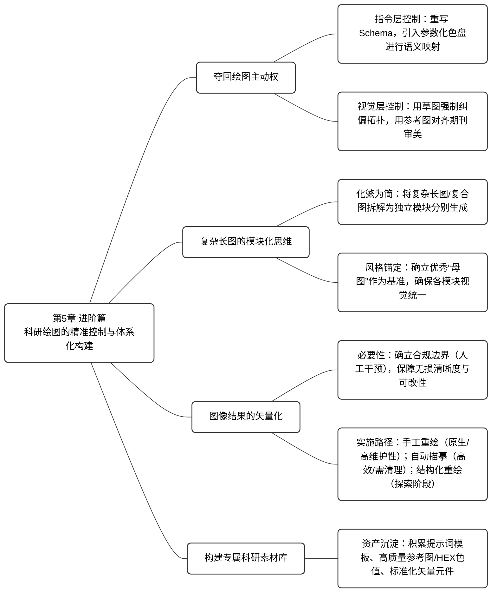

# 第5章 高阶控图：复杂长图拆解与论文插图的矢量化重构

> [!NOTE]
> **本章导学**
> - 掌握“母图锚定法”，确保系列插图风格的严格统一
> - 学习“模块化拆解思维”，破解 AI 处理复杂长图的逻辑瓶颈
> - 理解“矢量化重构”在合规性、出版清晰度与可持续修改中的核心价值
> - 开始构建个人专属的科研绘图素材库与元件库

在第 2~4 章中，我们已经系统学习了如何借助生成模型与相关工具，高效获得结构清晰、语义正确的科研插图初稿。从工具认知，到完整工作流的搭建，再到具体领域示例，相信你已经具备了独立完成科研插图生成的基本能力。

但在真实的科研写作与投稿过程中，仅仅“生成一张看起来不错的图”，还远远不够。随着论文反复修改、审稿意见不断往返，插图需要被频繁调整、扩展，甚至在不同论文和汇报中被再次使用。如果生成结果无法被持续编辑和稳定复用，其初期带来的效率优势很快就会被后期的维护成本抵消。

因此，本章致力于构建一套高标准的科研绘图体系。本章将不再局限于追求单次生成，而是深入探讨如何突破提示词的边界，通过精确控制、模块化拆解与标准化处理，将 AI 的随机产出转化为严谨、合规且可长期复用的科研资产。

## 5.1 重新建立科研绘图的主动权

生成模型在科研绘图中的最大优势，在于能够在极短时间内给出一个结构完整、信息充分的视觉方案。但与此同时，这类结果也往往伴随着一个容易被忽视的隐患，即对后续修改缺乏足够的控制力。

在初稿阶段，这一问题并不明显。但随着使用场景从“生成初稿”进入“反复修改”，许多隐藏的问题会逐渐显现——模块比例难以精调，局部结构无法单独调整，多张插图之间的风格也容易出现偏差。这些问题在论文修改阶段会被不断放大，往往会显著拉高后续维护成本。

因此，在生成完成之后，你需要做的第一件事，并非继续追求画面细节，而是重新接管绘图过程的控制权。这一控制权主要体现在两个层面：一是对生成指令本身的再加工，二是通过更直接的方式约束模型的视觉理解。

### 5.1.1 指令层的结构控制

第 03 章曾建议，在进入阶段二前，应当仔细检查 LLM 生成的 Schema ，并在后续交互中根据需要进行修改。之所以要这样做，是因为生成的 Schema 是你最终提供给 Nano-Banana Pro 的核心提示词。引入 LLM 的初衷在于帮助研究者从论文文本中快速外化出图像的整体布局与模块关系，尤其是在对整张图的拓扑结构尚未形成清晰认知的阶段。

但当你已经拿到一版可用的初稿之后，情况往往会发生变化。随着对论文内容和插图用途的反复推敲，你对“这张图最终应该长成什么样”会逐渐形成更明确的判断，包括结构取舍、信息层级，乃至整体视觉风格。在这一阶段，继续完全依赖模型自动生成的 Schema，反而可能限制你的表达。更合理的做法，是基于已经建立起来的完整认知，对 Schema 进行有意识的重写和精修，让它真正服务于你的设计意图。

这种重写并不仅限于结构层面的增删与调整，还应当覆盖那些在初始生成中容易被忽略，但在正式科研插图中至关重要的约束条件。其中一个常被低估，却极其关键的维度，就是色彩。

在进阶的科研绘图语境中，色彩不再只是审美层面的自由发挥，它承担着信息区分与语义映射的功能。因此，在重写 Schema 时，建议**将色彩管理一并纳入提示词设计**。具体来说，你可以从顶级期刊或高质量论文插图中提取稳定、被反复验证过的 HEX 色值，构建一组固定的色盘，并在 Schema 中明确规定各类模块、流程或概念所对应的具体颜色编码，参数化控色详见2.2.1节。

这些 HEX 色值可以利用取色工具依次从图中选取。如果你有批量提取文献插图 HEX 色值进行分析的需求，也可以通过开源项目 colorgram.py 本地识别、导出。

这种参数化的色彩约束一旦写入 Schema，便会成为模型生成时必须遵循的硬性条件。它不仅能够显著提升单张插图的专业度，更重要的是，在涉及多张图表或系列图时，可以确保同一概念在不同图中始终保持一致的视觉指代，从而建立起连贯、可信的视觉语言体系。这一步，往往是科研插图从“看起来不错”走向“符合期刊审美规范”的分水岭。

### 5.1.2 视觉层的生成控制

即便经过多轮优化，语言描述本身依然存在边界。对于某些复杂的空间拓扑关系，或对视觉张力要求较高的结构示意，再精细的文字提示也难以完全复刻你脑海中的设想。

在第 03 章和第 04 章中，我们主要通过文本来引导生成 Schema 。但在实际操作中，你可能会发现模型依然难以理解某些非典型结构，或者在多张插图之间出现风格不统一的问题。在这种情况下，继续在文本框中反复微调形容词，往往收效有限。

此时，更有效的策略是引入更直接的视觉约束手段。结合 2.2 节中介绍的图生图和文生图方法，通过草图和风格参考图，对生成过程进行更明确的引导。

**1. 用草图强制纠偏拓扑结构**

在生成初稿的过程中，你可能会遇到模型顽固地将“输入层”放置在错误位置，或者始终无法正确连接两个特定模块的情况。这类问题并非源于提示词不够精准，而更多来自模型在空间理解上的固有倾向。

此时最直接的解法是**停止与文字指令的纠缠，直接画给它看**。正如 2.2.2 节中所提到的，你只需在纸上或白板工具（详见2.3.1节介绍的草图绘制工具）中快速勾勒出模块的相对位置与连接逻辑，将这张甚至略显潦草的草图作为骨架喂给模型。这类视觉输入在生成中的优先级高于文字描述，能够显著提升模型对拓扑关系的服从度。

**2. 用风格参考图明确期刊级视觉取向**

在第 03 章和第 04 章中，我们给出了多组基于具体研究领域总结的提示词范式。这些提示词来源于对典型论文插图的归纳，能够在多数情况下生成符合该领域常见使用习惯的示意图。

但需要明确的是，领域层面的常见风格，并不必然等同于某一具体期刊或会议的视觉审美。即便研究主题相同，不同期刊在配色倾向、线条处理和构图密度等方面，往往仍然存在稳定差异，而这些差异很难仅通过抽象文字被准确描述。

因此，当你已经明确目标投稿期刊，或对期刊整体风格有较高要求时，仅依赖通用领域提示词往往不足以获得理想结果。在这种情况下，更有效的做法是直接引入风格参考图，明确期刊层面的视觉取向。

具体而言，可以**从目标期刊已发表论文中选取一张与当前工作类型接近、且视觉效果令人满意的插图，将其作为风格参考输入生成流程**。通过这种方式，模型能够在笔触密度、配色策略和整体视觉节奏上获得更明确的约束，从而生成更贴近期刊审美的结果。

此外，这一方法并不局限于已有提示词覆盖的领域。如果研究方向较为小众，或不在前述章节所列举的典型范围内，同样可以通过风格参考图反向提炼出适用于该领域的定制化提示词。

灵活运用上述视觉控制手段，将帮助你突破纯文字指令的瓶颈，获得更符合预期且质量稳定的生成结果。

## 5.2 复杂长图的模块化思维

第 02 章中我们已经展示了 Nano-Banana Pro 对结构的理解能力，但 AI 在长时记忆和全局空间规划方面仍然存在客观限制。当插图的复杂度逐渐逼近甚至超过单一视图所能承载的范围时，无论是尺寸上的拉伸，还是信息密度的持续叠加，都容易触发模型在逻辑组织与空间布局上的失稳。在这类场景下，试图依靠一条不断膨胀的提示词来一次性完成整张插图的生成，往往难以获得稳定且可复用的结果。

因此，研究者需要主动调整绘图策略，将原本整体性的复杂任务拆解为若干结构明确、边界清晰的生成单元，再由人工完成最终整合与校正。

### 5.2.1 案例分析

通过第 3、4 章的多次实战可以发现，在当前模型能力条件下，确实可以通过一段较为详尽的提示词，让 AI 一次性输出结构看似复杂的长图。但进一步检查后往往会发现，这类结果在宏观层面虽然能够较好地贴合目标风格与主流程设计，在微观逻辑与关键语义细节上却容易积累隐蔽的问题。

更重要的是，这类问题在后续修改阶段往往并不“友好”。由于结构和元素已经在整体画面中相互嵌套，一旦需要针对某个局部进行校正，常常会牵连到其他区域，使得调整成本显著上升。

以图 5-1 为例，该图为采用第 03 章工作流，以论文 Tree-KG: An expandable knowledge graph construction framework for knowledge-intensive domains 的 Methodology 章节作为输入绘制的结果。初看之下，整张图版式规整，左、中、右三区划分明确，右侧的三维多层级结构也具备一定的视觉完成度。

图 5-1 所使用的 Schema 内容如下：

```text
1. Global Layout (全局布局)
   Structure: Left-to-Right Progressive Pipeline. The flow transitions from rigid structural extraction to dynamic semantic expansion, culminating in a layered topology.
   Background: Clean white canvas with a faint, technical isometric grid (light grey, 10% opacity) to support the 3D aspects of the graph layers.

2. Zone Definition (区域定义 - 核心)
   Zone 1 (Location: Left):
   Container Label: "INITIAL SKELETON CONSTRUCTION (Sec 3.2)"
   Shape: A tall, vertical rectangular panel with a light blue tinted background.
   Internal Structure:
   - Top: A stack of generic "Textbook/Corpora" icons.
   - Middle: A "Regex Parsing Gear" icon processing the text.
   - Bottom: A rigid Table-of-Contents (TOC) Tree. This is a strict hierarchical dendrogram showing Book -> Chapter -> Section -> Subsection.
   Key Text: "Text Segmentation", "TOC Extraction", "Explicit Relations"

   Zone 2 (Location: Center - The Core):
   Container Label: "ITERATIVE EXPANSION ENGINE (Sec 3.3)"
   Shape: A large central container with a dashed border, representing the "Black Box" processing. It contains three nested sub-modules arranged in a triangular cycle:
   Internal Structure:
   - Sub-module A (Top): "Node Refinement". Visualizes the Contextual Convolution (conv). A central node is surrounded by a halo, absorbing vector lines from neighbor nodes.
   - Sub-module B (Bottom Left): "Entity Optimization". Visualizes Aggregation (aggr) and Deduplication (dedup). Shows small clusters of nodes merging into single "Core" entities, or "Non-core" entities attaching to a parent.
   - Sub-module C (Bottom Right): "Link Prediction Logic". Visualizes Eq(1). A dotted line connects two nodes (u, v). Floating above are three small icons representing the metrics: a Cosine wave, a Triangle (for Common Neighbors/AA), and a Path icon (for Common Ancestors).
   Key Text: "Contextual Convolution", "Edge Scoring (AA+CA)", "Entity Aggregation"

   Zone 3 (Location: Right):
   Container Label: "TREE-KG TOPOLOGY (Sec 3.1)"
   Shape: A clear glass-like 3D container.
   Internal Structure:
   - A Multi-Layered Graph view (Layers V1 ... Vk).
   - Vertical Pillars: Thick, solid lines representing Hierarchical Edges (E1) connecting layers.
   - Horizontal Webs: Thinner, colored lines representing Relational Edges (E2) within the same layer.
   Key Text: "Vertical Hierarchy (E1)", "Horizontal Relations (E2)", "Layered Knowledge"

3. Connection Logic (连接逻辑)
   Main Flow: A wide, grey block arrow labeled "Skeleton Initialization" flows from Zone 1 to Zone 2.
   Internal Cycle: Inside Zone 2, circular arrows connect the three sub-modules (Refinement -> Optimization -> Prediction) to represent the "Iterative" nature of the expansion.
   Output Flow: A double-lined arrow labeled "Structure Integration (merge)" flows from Zone 2 to Zone 3.
```

<div align="center">
<table>
  <tr>
    <td align="center"></td>
  </tr>
</table>
图 5-1　基于长提示词一次性生成的 Tree-KG 框架示意图
</div>

很多研究者在得到这样一张图时容易产生“绘图已基本完成”的判断。然而，当我们将其放回科研论文的使用语境中，这类一步生成的高复杂度插图往往会暴露出更深层次的问题，主要体现在信息过载和结构语义与视觉编码不一致两个方面。

**1. 信息过载**

图 5-1中堆叠了大量文字标签，例如Regex Parsing Gear（正则表达式解析装置）、Contextual Convolution (上下文卷积)等。AI 在生成过程中倾向于尽可能完整地复现提示词中的描述内容，从而将本应通过视觉抽象表达的信息，直接转化为文本元素堆积在画面中。这种做法削弱了插图的视觉归纳能力，使其更像一张结构化笔记，而非真正意义上的科研论文插图。这也与 1.2 节中提到的科研美学通用法则相违背。

**2. 结构语义与视觉编码的不一致**

尽管整体布局在形式上较为合理，但在需要严格表达结构语义关系的局部区域，仍然存在明显问题。以图 5-1　右侧的多层级知识图谱结构为例，根据论文原文描述，该部分应展示的是一个随着知识规模扩展，在层内与层间均存在明确连接关系的图谱结构。然而在生成结果中，这些关系更多停留在形式暗示层面，未能通过稳定、可辨识的视觉编码加以明确表达。

具体而言，生成图中层内节点数量与连接关系被弱化甚至模糊化，跨层级实体映射未得到清晰呈现；节点颜色的语义指向缺乏一致定义；同时，“Multi-layered Graph” 与 “Horizontal Relations” 等标注在语义对应关系上也出现了明显偏差。这些问题并非源于单一局部错误，而是复杂结构在整体生成过程中，其结构语义难以被持续、精确地映射到视觉符号体系中所导致的系统性偏移。

为了修正上述信息过载与多层级结构表达失真的问题，按照 5.1 节的方法，可以通过调整 Schema 或引入更严格的视觉层控制来进行修补。但在这样一张元素高度耦合的复杂插图中，无论是局部修改还是结构性调整，都极易引发连锁影响，使整体稳定性进一步下降。

正因如此，仅依赖事后修正并不足以从根本上解决问题。要获得可控且可维护的复杂插图结果，绘图思路本身需要发生转变。

### 5.2.2 复杂图形的拆解与生成

在科研写作中，真正需要引入模块化策略的复杂图形，主要集中在两类典型形态上：复杂长图，以及由多个子图构成的复合型大图。

**1. 复杂长图**

这类插图通常用于展示完整算法流程、系统架构或多阶段分析路径，其共同特征是信息链条较长、模块数量较多，并且对上下游关系的表达精度要求较高。在这类场景中，复杂度本身已经超过单一视图稳定承载的上限，图 5-1 所示案例即为复杂长图的典型体现。

更稳妥的做法是**在逻辑层面先将整张长图拆分为输入、处理、输出等若干相对独立的子模块**。针对每一个子模块，分别采用
5.1 节中已经验证有效的 Schema
与视觉约束进行生成，只在局部范围内追求结构正确与语义清晰，从而避免复杂度在单次生成中集中爆发。

**2. 由多个子图组成的复合型大图**

以图 5-2　所示论文中常见的图 A、B、C 组合形式为例。这类插图在版面上虽然被拆分为多个子图，但在审稿语境中依然被视为一个整体。其难点并不在于结构是否足够复杂，而在于不同子图往往承担着不同层级、不同抽象程度表达任务。在一张复合型大图中，涵盖应用场景、结构示意、工作原理等子图，在视觉风格上可能天然属于不同类型，例如子图 A 是 2D 抽象示意图、子图 B 是 3D 结构拆解图。在这种情况下，若尝试整体生成，模型往往会在不同风格约束之间做出折中处理，导致每一部分的表现力都被削弱。

<div align="center">
<table>
  <tr>
    <td align="center"></td>
  </tr>
</table>
图 5-2　融合不同视觉风格的复合型插图案例<sup>[6]</sup>
</div>

因此，这类复合图更适合**在生成阶段将每一个子图视为独立模块分别绘制**，使每个子图都能在自身最合适的视觉范式下完成表达，**再通过统一的风格约束与人工排版完成整体整合**。

### 5.2.3 基于母图的风格锚定

当复杂图形被拆解为多个模块分别生成后，新的挑战随之出现，那就是如何保证这些局部结果在最终合成时仍然保持高度一致的视觉风格。

在完成第一张令人满意的插图后，后续工作的重点便从“创造”转向了“对齐”。为了确保最终的插图在视觉上具有统一风格，仅依赖“扁平化设计”或某某会议风格这类泛化标签往往是不够的。

更有效的做法，是将你最满意的那张生成结果作为“母图”引入后续生成流程。通过图生图的方式，在生成新的模块或子图时，**要求模型严格参考该母图的笔触密度、配色策略、线条粗细与整体视觉节奏**。这种基于具体图像特征的风格锚定方式，能够显著降低模块化生成过程中出现风格漂移的风险。

在模块化绘制复杂插图时，母图所起的作用并不只是风格示范，更像是一种项目级的视觉基准。它确保了无论模块如何拆分、生成顺序如何变化，最终拼合出来的整张图，依然能够形成稳定而统一的视觉语言。

## 5.3 图像结果的矢量化

在 5.2 节中，我们已经讨论了通过模块化策略来应对复杂科研插图生成的不稳定性问题。无论是复杂长图，还是由多个子图构成的复合型大图，其最终形态往往都需要回到 PPT、Illustrator 等绘图环境中进行人工整合。

从操作层面来看，这一整合过程本身既可以基于位图完成，也可以通过矢量方式进行。因此，是否进行矢量化，并不是一个技术上的必然选择。但是需要强调的是，无论是否使用了模块化策略的AI生成的插图，本书都建议进行矢量化，并人工进行修正、调整。这是一个与科研规范、后续使用场景和编辑需求密切相关的决策。

本节将围绕这一决策展开讨论，重点分析在科研写作语境中，为什么矢量化会成为几乎不可回避的一步，以及在此基础上应如何选择合适的实现路径。

### 5.3.1 为什么必须进行矢量化

矢量化的首要动机，并不来自美观或效率，而来自科研规范本身——   AI 生成的位图结果，即便在内容上完全正确，但其生成过程依然难以满足论文对“作者实质性参与绘制过程”的要求。通过矢量化所引入的重绘、重构与人工编辑环节，插图从“模型输出结果”转变为“作者主导完成的科研图像”，从而在伦理与署名层面建立清晰边界。

这一重绘过程并不是形式上的规避，而是实质性的再创作。无论是结构线条的重新组织，模块边界的明确划分，还是文字标注的重新排版，矢量化都意味着作者对图像内容进行了可审查、可追溯的人工干预。这正是 AI 辅助绘图能够被期刊接受的关键前提。

在此基础上，矢量化还同时解决了位图插图在科研写作中的一系列现实问题。

首先是清晰度问题。AI 生成的文字元素，即便语义正确，也常以位图形式嵌入画面，在缩放或版式调整后容易出现模糊、变形等情况。通过矢量化重新插入的文字与线条，**可以以百分百矢量形式呈现，确保在任意分辨率下的清晰度与一致性**。

其次是修改便利性。在论文反复修改过程中，插图往往需要进行大量局部调整，例如模块名称替换、文字位置微调、线条粗细统一等操作。矢量对象可以被独立选取、精确移动和单独编辑，使这些修改成为低成本操作，而不再需要回到生成阶段重新开始。

因此，矢量化在科研绘图流程中同时承担了三重角色， 一是合规层面的必要转换，二是清晰度与版式稳定性的保障， 三是支撑长期修改与复用的基础条件。

### 5.3.2 矢量化路径

在 2.3.2 节中，我们已经了解了当前常见的矢量化工具类型。但在真实的科研绘图场景中，矢量化并不存在唯一标准路径，其具体实现方式往往取决于研究者对绘图工具的熟悉程度、插图的复杂类型，以及后续修改的频率与深度。

综合实践经验，现阶段较为可行的矢量化路径大致可以分为以下三类。为了帮助你根据具体需求快速定位合适的方案，表 5-1　从核心优势、主要局限及推荐适用场景三个维度，对这三种路径进行了横向对比。

表 5-1　常见矢量化路径特性对比

| **路径类型** | **典型工具** | **核心优势** | **主要局限** | **推荐适用场景** |
|:--:|----|----|----|----|
| **基于位图参考的人工重绘** | PPT, Figma, Visio | 逻辑结构清晰，原生矢量对象，后期维护与复用成本极低 | 初始绘制需要投入较高的时间成本 | 流程图、系统架构图、逻辑关系明确的示意图 |
| **基于工具的自动描摹** | Illustrator, Vectorizer | 初始转化效率高，能较好保留原图的色彩与笔触 | 路径节点冗余，文字识别效果差，通常需人工清理 | 色块清晰、风格扁平的非文字密集型插图 |
| **基于 AI 识别的结构化重建** | [Edit-Banana](https://github.com/BIT-DataLab/Edit-Banana), [Paper2Any](https://github.com/OpenDCAI/Paper2Any) | 引入语义理解（OCR/VLM），尝试解析图中的文本与拓扑关系 | 尚处探索阶段，稳定性与可控性无法完全替代人工 | 前沿工具尝鲜，引入人工审核的快速转换 |

**1. 基于位图参考的人工重绘**

如果你擅长使用 PPT、Figma、Visio等工具完成论文插图，最稳妥的方式是将 AI 生成的高清位图作为底图参考，在其上手动重绘关键结构。

这种方法在初期需要一定时间成本，但其优势在于最终得到的图形完全由原生矢量对象构成，层级关系明确，逻辑结构清晰，后续无论是局部修改、整体调整还是跨版本复用，成本都极低。该方式尤其适用于流程图、系统架构图以及逻辑关系明确的示意性插图。

**2. 基于工具的自动描摹**

如果你熟悉 Illustrator 等专业绘图软件，可以利用其图像描摹功能，将位图快速转换为矢量路径。这一方法在色彩边界清晰、风格扁平的插图中效率较高，能够显著缩短初始矢量化时间。

处理完成后，依次点击“扩展”与“取消编组”，即可对各个矢量对象进行灵活拖动或单独编辑。图 5-4 所示的是图 3-2 基于上述参数的图像描摹结果。

<div align="center">
<table>
  <tr>
    <td align="center"><br>(a)</td>
    <td align="center"><br>(b)</td>
  </tr>
  <tr>
    <td align="center"><br>(c)</td>
    <td align="center"><br>(d)</td>
  </tr>
</table>
图 5-3　Illustrator “图像描摹”面板 (a) 选择高保真度图片 (b) 设置推荐参数 (c) 点击扩展 (d) 点击取消编组
</div>

<div align="center">
<table>
  <tr>
    <td align="center"></td>
  </tr>
</table>
图 5-4　图 3-2 对应的矢量化重构结果
</div>

可以看到的是，自动描摹生成的路径往往在结构层面仍然较为粗糙，尤其是对文字部分的识别效果有限，通常仍需经过人工清理与重组，才能满足科研插图对逻辑清晰度和可维护性的要求。

在实际测试中，描摹效果对参数设置和图像风格高度敏感，需要通过反复微调颜色、路径、边角、杂色，可以获得相对可用的结果，也需要一定的反复试验。

若缺乏 Illustrator 环境，也可借助 Vectorizer 等在线工具完成基础矢量化处理，但在精度控制和结构可调性方面通常不及专业软件。

> [!TIP]
> **本书建议**：在执行自动描摹前，建议先通过高清放大工具（如第 02 章提及的 Real-ESRGAN 系列模型）将原始位图进行预处理。理论上，输入的位图分辨率越高、边缘锐度越强，自动描摹生成的路径就越平滑且贴合原貌。

**3. 基于 AI 识别的结构化重建**

除上述成熟方案外，近年来也出现了一些尝试从结构层面重建科研插图的探索性工具，例如 Edit-Banana、Paper2Any 等。这类工作不再将 AI 生成的插图视为单纯的图像，而是尝试将其通过图像分割模型对输入图像进行实例分割，并引入视觉大模型（Visual Large Model，VLM）、OCR模型将图片解析为由文本、形状、连接关系构成的结构化对象，再导出为可编辑格式。

需要指出的是，这些工具目前仍处于探索或早期应用阶段，在稳定性和可控性方面尚无法完全替代人工重绘或半自动流程，但它们所代表的方向，值得在未来科研绘图工作流中持续关注。

## 5.4 构建你的科研绘图素材库

当你逐渐熟练地掌握第 2~4 章所介绍的绘图流程后，往往会意识到一个现实问题：真正耗时的并非单次作图，而是不断从零开始的重复劳动。将已经验证有效的中间成果系统性地沉淀为可复用的资源，能够显著降低后续科研绘图的边际成本，从而实现效率上的跃迁。因此，本节将从提示词模板、高质量科研插图示例以及矢量元件的长期积累三个维度出发，系统讲解如何构建并管理你的个人科研绘图素材库。

**1. 提示词模板**

经过多轮反复调试并最终定型的 Prompt，并不只是一次性的指令，而是一套逐渐贴合你个人审美与研究方向的定制化模板。第 3、4 章所给出的更多是通用范式，而当你真正完成一整套满意的插图后，这套 Prompt 已经内化了你对科研绘图风格与结构表达的个人偏好，其价值显著高于通用示例。

因此，建议单独保存完整 Prompt，并将其中关于视觉风格、版式组织与表达习惯的核心描述抽离出来，例如对整体风格的定义方式、对模块层级与排列关系的描述逻辑。后续面对新的研究主题时，你只需替换关键概念与对象名称，便可快速复用这套已经被验证有效的表达框架，避免每次都从零开始摸索模型的响应边界。

**2. 高质量科研插图示例**

在绘图实践与日常文献阅读中，你往往会接触到大量高质量的科研插图示例，其中包括结构清晰的风格参考图、具有辨识度的配色方案，以及在实践中表现良好的排版布局。这些内容同样具有长期价值，应当有意识地加以积累。

具体而言，可以将优秀的科研绘图示例单独保存为风格参考或颜色参考，同时提取其中成熟的配色方案并记录对应的 HEX 色值。此外，对于你借助 AI 绘制并且效果满意的插图，也应一并归档保存。随着积累的增加，你将逐步形成一个高度贴合自身研究方向的参考图库，在后续开展新工作时，为风格决策提供稳定而可靠的依据。

**3. 矢量元件的长期积累**

在 5.3 节的矢量化流程中，你通常会得到一批结构明确、表达规范的图形元素，例如神经网络结构示意、标准化的模块或系统图标。这些元素在经过人工校正与语义确认后，便可以转化为可长期复用的科研绘图组件。

因此，建议将这些矢量元件从原始插图中拆分出来，按照功能或语义类型进行分类保存。随着时间推移，它们会逐渐构成一个专属于你的标准化元件库。在后续工作中，无论是在手动调整时快速调用，还是作为 AI 生成的参考垫图，只需搭建新的整体框架，再组合这些成熟组件，便能够在极短时间内完成一张风格统一、逻辑严谨且符合期刊规范的科研插图。

> [!TIP]
> **本章核心结论速查**
> - **控制权**：利用参数化色彩（HEX）与草图（Sketch）强行修正模型的生成偏好
> - **拆解术**：化整为零，分模块生成后再人工合成，是处理“科学大图”的终极方案
> - **矢量化**：从 AI 素材到论文插图的“惊险一跃”，建议作为每张出图的必经环节
> - **资产化**：好的提示词、母图和矢量元件应作为“科研资产”进行长期归档

## 5.5 小结

本章重点探讨了如何将 AI 绘图从随机生成转化为精确可控的创作过程。首先，通过引入 Schema 重构与视觉约束手段，不再被动接受模型的随机生成，而是让结果精准落地；接着，利用模块化拆解与矢量化处理，解决了复杂长图的逻辑崩塌与期刊投稿的合规性难题；最后，将这些验证过的成果固化为素材库，完成了从单次创作到长期复用的效率闭环。

学会上述技巧后，你手中的 AI 就不再是一个单纯的画图工具，而是一套完整、严谨且高效的科研视觉生产体系。

为了帮助你更直观地复盘这一进阶路径，下面将本章的核心知识点梳理为了一张全景脉络图。



<div align="center">
  图 5-5　第 05 章知识脉络图
</div>
