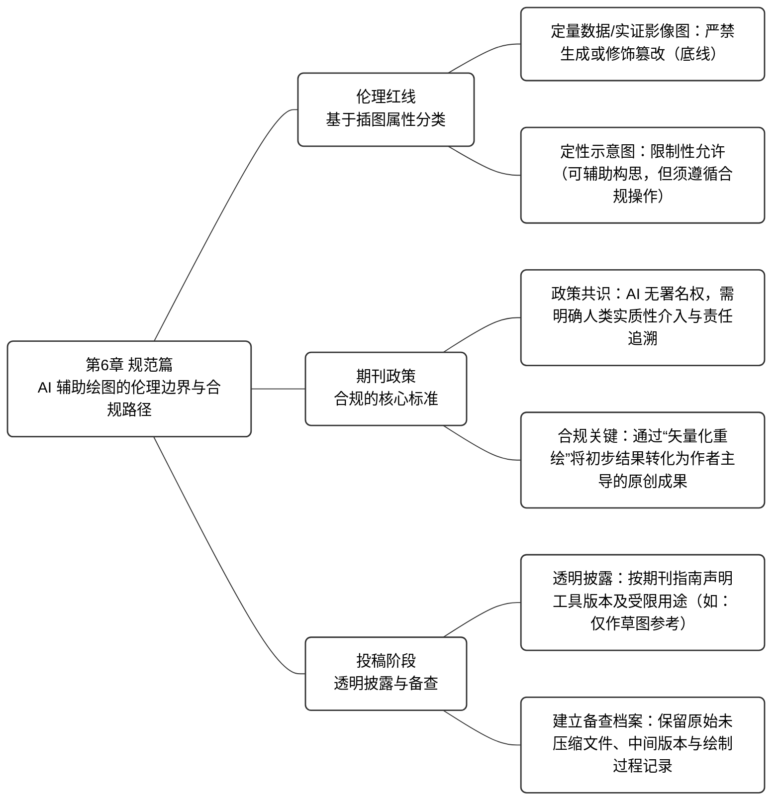

# 第6章 避坑指南：AI绘图的学术合规操作与版权界线

> [!NOTE]
> **本章导学**
> - 划清不同类型科研插图（定量、实证、定性）的 AI 使用伦理红线
> - 了解 Nature、Science、Elsevier 等主流期刊对 AI 生成内容的官方政策
> - 理解为什么“矢量化重绘”是让 AI 辅助流程合规化的关键环节
> - 掌握投稿阶段的透明披露模板与自查方法

在 2-5 章中，我们已经系统性地展示了如何使用 Nano-Banana Pro 辅助科研绘图，并通过多种案例说明了其在结构设计、布局规划与效率提升方面的价值。但当 AI 工具真正进入科研表达流程时，技术能力本身已不再是决定使用的唯一依据。科研绘图始终受到伦理规范、学术责任与出版规则的共同约束。

因此，本章不再讨论如何更高效地使用 AI 绘图工具，而是回到一个更根本的问题——在当前学术环境中，AI 科研绘图的使用边界在哪里，哪些行为是被明确禁止的，又如何在合规前提下合理引入 AI 辅助流程。

## 6.1 AI 科研绘图的伦理红线

科研绘图是否可以使用 AI，并不取决于工具能力本身，而取决于图像在科研论证链条中的功能定位。正如导论所提出的分类框架，科研插图并非统一处理对象，不同类型图像在信息属性与证据价值上存在根本差异。在规范层面，这种差异会直接转化为可接受性判断的分水岭。

表 6-1　对不同类型科研插图在 AI 使用上的伦理红线与合规操作进行了系统梳理，以当前主流学术规范与期刊审查实践为依据给出直接结论。

表 6-1　基于科研插图分类的 AI 伦理红线与合规操作对照表

| **科研插图分类** | **典型示例** | **AI 伦理红线** | **技术逻辑与合规操作** |
| :---: | :--- | :---: | :--- |
| **定量数据图** | 散点图、柱状图、折线图、热力图 | 严禁生成 | **技术逻辑：** 像素点必须对应真实数值。AI 生成属于“数据伪造”。  **合规操作：** 仅可使用 AI 编写绘图代码，图像必须由代码基于原始数据渲染。 |
| **实证影像图** | 显微镜照片、电泳胶图、病理切片、设备实拍 | 严禁修补/增强 | **技术逻辑：** 图像是物理样本的直接证据。AI 去噪或放大属于“无中生有”的篡改。  **合规操作：** 仅允许全图线性的亮度/对比度调整，禁止任何生成式填充。 |
| **定性示意图** | 机制流程图、信号通路图、模型架构图、封面图 | 限制性允许 | **技术逻辑：** 侧重逻辑表达与概念转译，不包含定量数据。  **合规操作：** 可使用 Nano-Banana Pro 生成草图，但必须经过矢量化重绘（第 05 章）并进行透明披露（ 6.3 节）。 |

需要强调的是，表 6-1　所划定的并非“技术可行性边界”，而是“学术责任可承担性边界”。当图像直接参与科研结论的成立过程时，其生成与处理方式必须保持完全可追溯；当图像仅用于辅助理解与概念表达时，AI 才具有相对明确且可控的使用空间。

## 6.2 从期刊政策看 AI 科研绘图的合规边界

围绕 AI 生成图像的使用，在当前法律与出版实践中，学界已逐步形成稳定共识：完全由生成式 AI 自动生成、且缺乏人类实质性介入的图像，难以被认定为符合科研出版所要求的原创性表达。

这一判断，并非针对 AI 技术能力本身的价值评估，而是源于著作权制度对“作者主导性”“创造性判断”与“责任可追溯性”的基本要求。国际出版伦理委员会（Committee on Publication Ethics，COPE）指出，AI 工具不具备人类作者的原创性意图，也无法承担署名与版权责任，因此作者必须对论文中出现的全部图像内容承担完整的学术与法律责任。（详见 [<u>https://publicationethics.org/cope-position-statements/ai-author</u>](https://publicationethics.org/cope-position-statements/ai-author)）

在具体执行层面，不同期刊与出版集团在措辞与适用范围上存在差异，但其规范导向高度一致：均对直接使用生成式 AI 产出的图像持严格限制态度，并将“是否存在可核查的人类创作路径”作为核心判断标准。表 6-2　汇总了主要国际期刊与出版集团在 AI 生成图像方面的公开政策立场，用以呈现这一共识在出版规则中的具体体现。

表 6-2　主流国际期刊对 AI 生成图像的声明与使用要求概览

<table> <colgroup> <col style="width: 12%" /> <col style="width: 9%" /> <col style="width: 77%" /> </colgroup> <thead> <tr> <th style="text-align: center;"><strong>期刊/出版集团</strong></th> <th style="text-align: center;"><strong>政策类型</strong></th> <th style="text-align: center;"><strong>官方核心要求</strong></th> </tr> </thead> <tbody> <tr> <td style="text-align: center;"><strong>Nature/ Science</strong></td> <td style="text-align: center;"><strong>完全禁止</strong></td> <td>涵盖所有插图、摄影和视频。除非 AI 本身是研究对象，否则绝对禁止。 （详见 <a href="https://www.nature.com/nature-portfolio/editorial-policies/ai"><u>https://www.nature.com/nature-portfolio/editorial-policies/ai</u></a>与<a href="https://www.science.org/content/page/science-journals-editorial-policies"><u>https://www.science.org/content/page/science-journals-editorial-policies</u></a>）</td> </tr> <tr> <td style="text-align: center;"><strong>Elsevier</strong></td> <td style="text-align: center;"><strong>原则禁止</strong></td> <td>明确禁止在正文图像和图形摘要中使用 AI。仅在封面图上保留了“向编辑申请特许”的机会。 （详见<a href="https://www.elsevier.com/about/policies-and-standards/generative-ai-policies-for-journals">https://www.elsevier.com/about/policies-and-standards/generative-ai-policies-for-journals</a>）</td> </tr> <tr> <td style="text-align: center;"><strong>ACS</strong></td> <td style="text-align: center;"><strong>限制性允许</strong></td> <td>允许用于图像生成，但必须在“致谢”或“方法”部分详细披露工具名称、版本及具体用途。 （详见 <a href="https://researcher-resources.acs.org/publish/aipolicy">https://researcher-resources.acs.org/publish/aipolicy</a>）</td> </tr> <tr> <td style="text-align: center;"><strong>JAMA Network</strong></td> <td style="text-align: center;"><strong>限制性允许</strong></td> <td>禁止 AI 署名。不鼓励提交使用AI 生成的图像。若使用必须披露，且作者必须能为图中每一处细节的真实性提供担保。 （详见<a href="https://jamanetwork.com/journals/jama/pages/instructions-for-authors">https://jamanetwork.com/journals/jama/pages/instructions-for-authors</a>）</td> </tr> </tbody> </table>

在上述政策背景下，直接将生成式 AI 输出的位图作为科研插图投稿，往往在版权归属与出版合规两个层面同时面临风险。 图像既难以满足原创性要求，也缺乏清晰的责任主体界定，从而成为编辑与审稿环节重点关注的潜在问题源。

因此，第 05 章所提出的矢量化重绘流程，在出版与投稿的语境中具有明确的合规价值。 通过对结构、布局与视觉表达的系统性重构，作者将图像转化为经由人类判断、选择与修正的科研表达成果。图像中所体现的创造性决策与科学责任由此可以清晰归属于作者本人，从而满足期刊对原创性与责任主体的基本要求。在这一意义上，矢量化重绘并非单纯的画质优化步骤，而是连接 AI 辅助流程与科研出版规范之间的关键合规环节。

## 6.3 投稿阶段的透明披露与自查建议

在完成第 05 章所述的矢量化重绘流程、人工审核与修正后，图像在当前主流国际期刊的规范框架内，通常已具备较高的合规安全性。 在这一流程中，AI 生成内容仅作为构思阶段的辅助草图，用于参考整体布局或配色方案，最终发表的图像由作者主导完成并承担全部学术责任。

在这种前提下，是否需要对 AI 的使用进行透明披露，不同期刊的要求并不完全一致。 部分期刊明确要求披露工具名称与用途，但在声明位置、表述细节上仍存在差异。因此，在投稿前，我们仍应以目标期刊的最新作者指南为准，避免因理解偏差引发不必要的合规风险。

出于稳妥的考虑，本书建议在致谢、方法部分或图注中，对 AI 工具的使用情况进行简要而明确的说明。 声明内容应包括所使用的工具名称、版本信息及具体用途，例如用于构思阶段、结构草图或配色参考，同时明确指出所有科学判断、结构设计与最终图像内容均由人类作者完成并负责。

以下是一种可供参考的英文声明模板：

> [!IMPORTANT]
> **英文声明模板**
>
> The authors acknowledge the use of Nano-Banana Pro for the initial conceptualization and color palette selection of Figure [X]. The final figure was manually redrawn as a vector graphic and verified by the authors to ensure scientific accuracy and compliance with publication ethics. The authors remain fully accountable for the integrity of the work.

在正式投稿前，我们还应从编辑与审稿人的视角，对全部插图进行系统性自查。 建议为每一张图像建立对应的原始材料包，完整保留未经压缩的原始文件、绘制过程记录以及关键的中间版本。 对于曾使用 AI 辅助的插图，可以提前准备好简要的说明文本与必要的操作记录，以便在编辑或审稿人询问时能够迅速、清晰地回应。

## 6.4 小结

本章围绕 AI 科研绘图在当前学术体系中的合规边界，从伦理红线、期刊政策与投稿实践三个层面进行了系统梳理。随着期刊政策与出版伦理逐步明晰，图像是否合规，已不再取决于工具来源，而取决于生成路径是否可追溯、责任是否清晰归属作者。

在这一前提下，本书所倡导的将 AI 仅作为科研绘图前期辅助、而非直接产出工具的技术路线，严谨契合了目前主流期刊的审核要求。这种将规范转化为操作习惯、主动使风险控制前置于创作过程的思路，构成了当前阶段更现实、也更稳妥的实践策略。

为了帮助你更直观地复盘本章要点，图 6-1　将本章核心内容整理为了一张全景式的知识脉络图。

  图 6-1　第 06 章知识脉络图

# 参考文献

\[1\] DeepSeek-R1. DeepSeek-R1 benchmark comparison figure\[EB/OL\]. (2025-1-20)\[2026-01-24\]. <https://github.com/deepseek-ai/DeepSeek-R1/blob/main/figures/benchmark.jpg>.

\[2\] Savage J C, Picard K, González-Ibáñez F, et al. A brief history of microglial ultrastructure: distinctive features, phenotypes, and functions discovered over the past 60 years by electron microscopy\[J\]. Frontiers in immunology, 2018, 9: 803.

\[3\] Vaswani A, Shazeer N, Parmar N, et al. Attention is all you need\[J\]. Advances in neural information processing systems, 2017, 30.

\[4\] Bustillo J P O, Engels E E M, de Rover V, et al. Three-dimensional bioprinted in vitro glioma tumor constructs for synchrotron microbeam radiotherapy dosimetry and biological study using gelatin methacryloyl hydrogel\[J\]. Scientific Reports, 2025, 15(1): 13868.

\[5\] Gowal S, Bunel R, Stimberg F, et al. SynthID-Image: Image watermarking at internet scale\[J\]. arXiv preprint arXiv:2510.09263,
2025.

\[6\] Tian S, Liu S, Zhu R. Flexible thermal array sensor for imperceptible monitoring of multidimensional vascular dynamics\[J\]. Science Advances, 2026, 12(3): eaea5803.